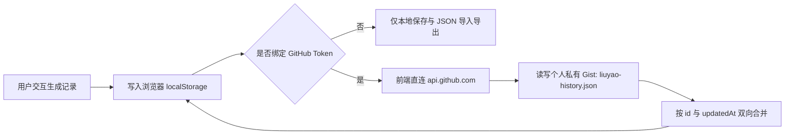

+++
title = '无后端如何存数据：GitHub Pages 下的浏览器存储与私有 Gist 实践'
description = "以六爻手记（Liuyao）实验项目为例，探讨纯静态 GitHub Pages 站点如何利用浏览器 localStorage 与 GitHub 私有 Gist 实现无服务器的数据持久化与跨设备同步。"
date = '2026-11-26'
draft = false
tags = ['工具', '学习笔记']
categories = ['Web']
toc = true
math = false
+++

## 介绍

在使用 `GitHub Pages` 部署个人网站时，一个绕不开的限制是它只托管静态资源，不提供服务端运行环境，也无法直接连接传统意义上的后台数据库。

但这并不意味着静态网页只能做“看完即走”的展示页。为了验证**不搭建任何自建后端时，纯静态网页究竟能把数据存储和同步做到什么程度**，我做了一个名为 `Liuyao`（观象 · 六爻起卦与断象手记）的单文件 HTML 实验项目，用来测试“浏览器本地存储 + GitHub 私有 Gist”这套零后端持久化方案的实际体验与边界。

---

## 静态网页存数据的几种可能

在没有自己服务器的前提下，前端页面想要保存用户产生的数据，通常有三条路径可选：

| 方案 | 数据存放位置 | 是否需要登录 | 跨设备同步 | 典型适用场景 |
| ---- | ------------ | ------------ | ---------- | ------------ |
| 浏览器本地存储 | 用户当前浏览器 | `false` | `false` | 单机工具配置、临时草稿、本地历史记录 |
| 用户私有 Gist | 用户个人 GitHub 账号 | `true` | `true` | 个人向工具、笔记、单机存档云同步 |
| 外部 BaaS 或 Serverless | 第三方云数据库或函数 | 按业务决定 | `true` | 全站共享排行榜、评论区、多用户协作数据 |

可以看到，决定选型的分水岭在于**数据归属权**：

- 如果数据需要所有访客共同读写，例如全服排行榜或公开评论区，依然必须依赖外部后端（如 Cloudflare Workers 或 Supabase）来做统一存储与权限校验。
- 如果数据只属于访客本人，例如个人笔记、工具设置或练习记录，完全可以让用户自己的浏览器直接对接其个人名下的存储空间，从而彻底省掉后端运维成本。

---

## 实验设计：浏览器存储与私有 Gist 联动

在 `Liuyao` 项目中，整体数据流采用“本地优先（Local-First）+ 可选云同步”的分层结构：



### 第一层：浏览器 `localStorage` 本地优先

网页打开时首先完全脱离网络依赖工作。所有的起卦结果、分类标签和事后复盘笔记，都会以 JSON 数组的形式实时写入浏览器本地：

- `liuyao.history.v1`：保存所有卜卦记录、更新时间与软删除标记。
- `liuyao.gistSync.v1`：保存当前绑定的 GitHub 用户名、头像、目标 `gistId` 以及用户粘贴的访问令牌。

同时页面内置了 JSON 文件的导出与导入功能。这样即使访客没有 GitHub 账号，或者只是临时试用，所有记录也能在当前设备完整保留，并在必要时手动迁移。

### 第二层：免后端 OAuth 的最小权限令牌接入

常规的“一键 GitHub 登录”在授权回调后需要用 `client_secret` 去换取用户令牌，而 `client_secret` 绝不能写进公开的静态前端代码里，因此标准 OAuth 往往还是需要一个小后端做中转。

为了保持纯静态架构，本项目改用了 **预设参数的细粒度个人访问令牌（Fine-grained PAT）** 方案。用户点击页面上的引导链接时，会直接跳转到 GitHub 官方的令牌创建页，并自动预填好名称、描述以及最小权限范围：

```text
https://github.com/settings/personal-access-tokens/new?name=Liuyao+Field+Notes&description=Liuyao+Gist+Sync&expires_in=none&gists=write
```

这样设计有三个直接好处：

- 权限严格收敛到 `gists=write`，不会读取或修改用户的任何代码仓库，心理负担小。
- 令牌只保存在用户自己浏览器的 `localStorage` 中，请求直接由浏览器发往 `https://api.github.com`，作者本身接触不到任何访客凭证。
- GitHub 官方 REST API 原生支持浏览器跨域请求（CORS），不需要自己架设代理服务器。

### 第三层：私有 Gist 的查找、双向合并与容错

连接令牌后，前端通过封装好的请求函数自动完成“定位存档 -> 拉取合并 -> 回写云端”的闭环：

- **自动定位或新建私有 Gist**：先通过 `GET /gists?per_page=100` 查找描述或文件名匹配 `liuyao-history.json` 的现有存档；如果未找到，则调用 `POST /gists` 创建一个 `public: false` 的私有 Gist。
- **按时间戳合并与软删除**：每条记录都带有唯一 `id` 与 `updatedAt` 时间戳。多台设备同步时，以 `id` 为键取 `updatedAt` 较新的版本；删除记录时不直接从数组物理移除，而是标记 `deleted: true`，防止另一台尚未同步的设备把旧记录重新合并回来。
- **处理大文件截断**：当单份存档内容较大时，GitHub API 响应中的 `content` 字段可能出现 `truncated: true`，此时需要继续请求返回的 `raw_url` 拉取完整文本。

核心合并与同步逻辑如下：

```javascript
function mergeRecords(localList, remoteList) {
  const map = new Map();
  for (const item of [...localList, ...remoteList]) {
    if (!item || !item.id) continue;
    const prev = map.get(item.id);
    if (!prev || (item.updatedAt || "") > (prev.updatedAt || "")) {
      map.set(item.id, item);
    }
  }
  return Array.from(map.values()).sort((a, b) =>
    (b.createdAt || "").localeCompare(a.createdAt || "")
  );
}
```

在写入云端时，如果解析现有 Gist 的 JSON 失败，代码会主动中止同步并抛出提示，避免异常格式直接覆盖掉已有存档。

---

## 实践边界与注意事项

通过这次实测可以看到，在纯静态网站中用 `localStorage` 配合私有 Gist 是完全可行的，但也存在清晰的适用边界：

- **Secret Gist 不等于加密保险箱**：API 中的 `public: false` 只代表该 Gist 不会被公开索引和检索，但只要持有其随机链接仍可读取内容，因此不应在前端存档中记录密码或高度敏感的隐私凭证。
- **浏览器 `localStorage` 容量与清理风险**：单域名下的 `localStorage` 通常只有约 5 MB 空间，适合文本与结构化 JSON，不适合存图片或音视频；且用户清除浏览器站点数据后本地记录会丢失，这也是接入 Gist 或提供 JSON 导出的必要性所在。
- **Token 生命周期与使用门槛**：Fine-grained PAT 虽然可以设置不过期并精确限定到 Gist 权限，但仍需要用户手动生成并粘贴一次，更适合开发者或习惯使用 GitHub 的工具受众。

整体来看，对于个人学习实验、轻量记录型工具或单机小应用而言，“静态页面 + 浏览器本地存储 + 个人私有 Gist” 已经能够以零服务器成本提供相当完整的跨设备使用体验。

---

## 参考

- **Liuyao 项目源码仓库**：https://github.com/Zero-Kq/Liuyao
- **Liuyao 在线演示页面**：https://zero-kq.github.io/Liuyao/
- **GitHub REST API Gists 官方文档**：https://docs.github.com/en/rest/gists/gists
- **MDN Window.localStorage 文档**：https://developer.mozilla.org/zh-CN/docs/Web/API/Window/localStorage
